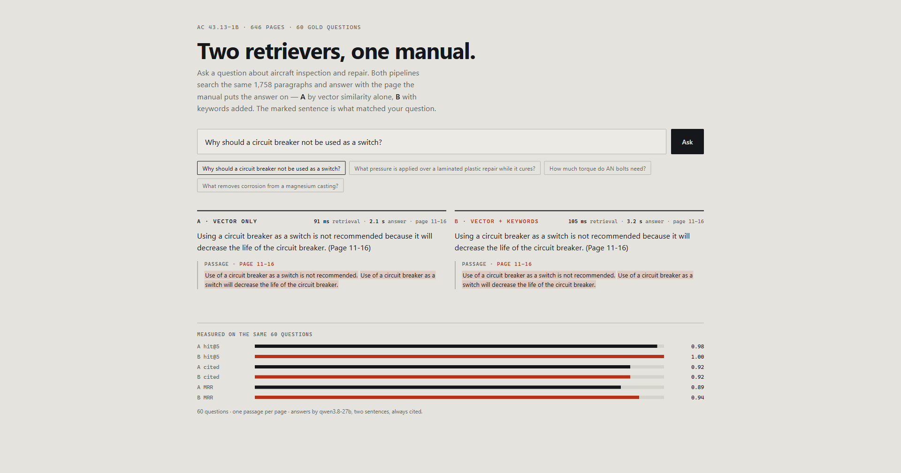

# manual-rag-evals

Ask an aircraft-maintenance manual a question; two retrievers answer, and every answer
names the page it came from.



## What this is

FAA AC 43.13-1B, *Acceptable Methods, Techniques, and Practices — Aircraft Inspection
and Repair* (646 pages, public domain), cut into **1,758 paragraphs**. Each paragraph
keeps the manual's own footer label, so a citation is `Page 6-30` — the page a mechanic
would open — and not a PDF index.

Two pipelines over the same paragraphs:

| | retrieval | embedding |
|---|---|---|
| **A** | vector only, cosine | `qwen3-embedding:0.6b`, 1024-d, local |
| **B** | BM25 + vectors, reciprocal rank fusion | same |

Answers are written by a local model (`qwen3.8-27b` through Ollama) from the retrieved
paragraphs, one per page, and it is told to end with the page it used. If Ollama is not
running, the app shows the passage and its page instead of inventing an answer.

## The measurement

**60 questions**, each with the printed page that answers it, every page verified by
re-reading it (see `eval/check_gold.py`). Five retrieved paragraphs per question.

| pipeline | hit@5 | MRR | answer cites the gold page |
|---|---|---|---|
| A · vector only | 0.98 | 0.894 | 0.92 |
| B · hybrid | **1.00** | **0.939** | **0.92** |

A misses exactly one: "how is pressure applied over a laminated plastic repair while it
cures" (Page 3-4) returns Pages 1-25, 3-6, 3-1 and 3-7 instead. B finds it.

The last column is the one that matters to a reader and the one most demos skip: the
model answered all 60 questions and named the correct page in 55. Retrieval is not the
limit — both pipelines put five pages in front of the model, and in five cases it quoted
a page other than the gold one. That gap is the honest cost of generation, and it is why
the page marks the sentence the answer came from instead of asking for trust.

The caveat, stated plainly: the questions were written after reading passages that
retrieval had already returned, so both pipelines are flattered and hit@5 is close to
its ceiling. The honest signal here is MRR — B puts the right page first more often —
plus the one question A cannot reach at all. A harder, paraphrase-only set is the next
thing this repo needs; its absence is the weakest part of the result.

## Where the time goes

One question, both arms, measured on this machine:

| step | time |
|---|---|
| retrieval, both pipelines | 45 ms |
| one answer | 1.9 s |
| the two arms, side by side | 2.5–3.6 s |

Retrieval is about 2% of the wait, so no storage engine can make this feel faster. The
1,758 paragraphs and their 1,024-dimension vectors fit in memory, and a cosine sweep is
20 ms. A vector database earns its place at millions of chunks, metadata filters, or
writes during queries — none of which this corpus has. The time is the 27B model, and
the levers that matter are the ones already pulled: an 8k context keeps it on the GPU,
`think: false` stops it spending the token budget on reasoning, and the two arms no
longer wait for each other.

## Three commands

Needs `pdftotext` (Poppler) and a running Ollama with `qwen3-embedding:0.6b`.

```bash
uv venv && uv pip install -r requirements.txt
python -m app.setup            # download the manual, extract, embed (about a minute)
python -m uvicorn app.main:app --port 8041
```

Open <http://127.0.0.1:8041>. It runs on your machine only: the model is a 17 GB local
27B, so the demo holds two generations at a time and refuses the third with a 429 rather
than queueing it. `python -m eval.run_eval` re-scores both pipelines and
rewrites `eval/results.json`; `python -m eval.check_gold` proves all 60 gold pages.

## Layout

```
app/corpus.py   646 pages -> citable paragraphs
app/embed.py    embeddings, cached in data/embeddings.npz
app/search.py   BM25, vector search, fusion
app/main.py     FastAPI: /api/ask, /api/results, the page
eval/gold.jsonl 60 questions with page + the sentence that proves it
eval/run_eval.py hit@5, MRR and citation accuracy for both pipelines
public/index.html  the page (no build step)
```

## Non-goals

No fine-tuning, no OCR, no second manual, and no answer without a citation.
