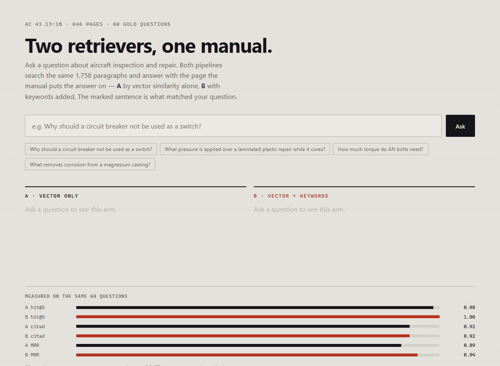
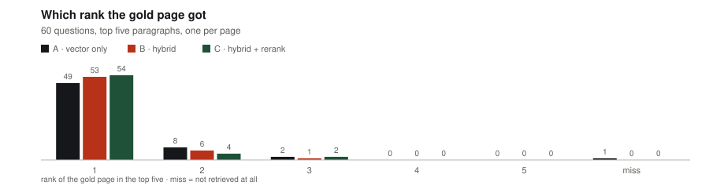
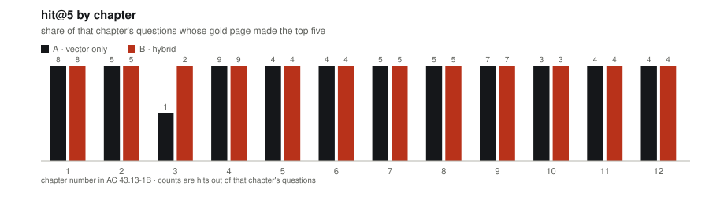

# manual-rag-evals

Ask an aircraft-maintenance manual a question; two retrievers answer, and every answer
names the page it came from.



Three questions, unanswered at the start. Each one sends five paragraphs to both pipelines;
the page shows what each arm answered, which page it used, and the sentence that matched.
The first asks about a circuit breaker (both cite Page 11-16), the second is the one A
misses, the third is a flutter question whose citation lands on the wrong page.

[Play it with controls](docs/demo.mp4) (26 s, 365 KB).

FAA AC 43.13-1B, *Acceptable Methods, Techniques, and Practices — Aircraft Inspection
and Repair*: 646 pages, public domain, 1,758 paragraphs. Ask "why should a circuit breaker
not be used as a switch?" and both pipelines answer from the same passage on **Page
11-16**.

The point is not that a model can quote a manual. The point is that the quote is checkable:
the page number is the manual's own, and the sentence that matched is marked under the
answer.

---

## What it does

One question goes to two retrieval pipelines at once. Each returns five paragraphs, at most
one per page. A local 27B model writes a two-sentence answer from those paragraphs and is
told to end with the page it used. The page shows the two answers side by side with their
timings, the passage behind each one, and the highlighted sentence that matched.

| | retrieval | embedding |
|---|---|---|
| **A** | vector only, cosine | `qwen3-embedding:0.6b`, 1024-d, local |
| **B** | BM25 + vectors, reciprocal rank fusion | same |

Generation is `qwen3.8-27b` through Ollama. If Ollama is down, the app shows the passage and
its page instead of inventing an answer, and says so in italics.

---

## How it was built

1. **Pick a document a reader can check.** AC 43.13-1B is the FAA's handbook of acceptable
   repair methods. It is public domain, it is text (no OCR), and every page carries its own
   label in the footer: `Page 6-30`, plus a paragraph number `Par 6-151` on most pages.
   That label is the product. A citation has to lead back to the page a mechanic opens, not
   to a PDF index.
2. **Extract without destroying the reading order.** `pdftotext -raw`, not `-layout`: the
   manual is two columns, and layout mode interleaves them into sentences like "IN-PLACE
   TREATMENT OF c. Strip paint if required. MAGNESIUM CASTINGS". The PDF also splits words
   across lines ("rea­ son", "de- vices"); `app/corpus.py` repairs both.
3. **Cut on the manual's own boundaries.** Paragraphs start with `6-151.`; the splitter
   uses those markers, drops table-of-contents rows (dot leaders), running headers and
   footers, and cuts anything past ~1,100 characters at a sentence end. Each chunk keeps
   `page`, `pdf_page`, `par` and `text`.
4. **Embed once, cache with a fingerprint.** `app/embed.py` writes `data/embeddings.npz`
   with a SHA-256 of the joined chunk text. Startup compares fingerprints and refuses to
   run on a mismatch, because chunk ids are positional: edit the text, forget to re-embed,
   and every later id points at a different paragraph. That failure is silent, so it is
   checked.
5. **Write the questions before the scores.** 60 questions, each with the page that answers
   it and the sentence that proves it (`eval/gold.jsonl`). `eval/check_gold.py` re-reads every
   cited page and fails if the evidence sentence is not there. Questions were written after
   reading the page, never from memory.
6. **Score retrieval and generation separately.** `eval/run_eval.py` reports hit@5, MRR, and
   whether the generated answer cites the gold page. The third number is the one a reader
   cares about and the one most demos skip.

---

## How it works

```
question
   |
   +--> A: embed -> cosine over 1,758 vectors -> top 5 (one per page)
   |
   +--> B: BM25 top 30 + cosine top 30 -> reciprocal rank fusion -> top 5
   |
   +--> both prompts to qwen3.8-27b, in parallel
   |
   +--> {answer, page, highlighted sentence, retrieval ms, answer ms}
```

- `POST /api/ask {"q": "..."}` returns both arms. `q` is 3–400 characters; anything else is
  a 422 before a model is touched.
- `GET /api/results` returns `eval/results.json` for the bars at the bottom of the page.
- `GET /` serves `public/index.html`, one file, no build step.
- Two generations run at a time (`threading.Semaphore(2)`); a third request gets a 429
  instead of a queue. This is a 17 GB local model, so the demo is local by design.
- Context is capped at 8k and `think: false` is set. Without those, Qwen3 spends its whole
  token budget on hidden reasoning and returns an empty answer — the bug that made the
  first demo seem broken.

---

## The measurement

60 questions, five retrieved paragraphs each, every gold page verified by re-reading it.

| pipeline | hit@5 | MRR | answer cites the gold page |
|---|---|---|---|
| A · vector only | 59/60 | 0.894 | 55/60 |
| B · hybrid | **60/60** | **0.939** | **55/60** |

One question is worth 1.7 points at this size. The 95% intervals are wide enough to swallow
every gap in that table except the miss itself — hit@5 is 0.91–1.00 for A and 0.94–1.00 for
B; citation is 0.82–0.96 for both. That is why the counts are written as counts.

A misses exactly one page: "how is pressure applied over a laminated plastic repair while
it cures" (Page 3-4) returns Pages 1-25, 3-6, 3-1 and 3-7 instead. B finds it.

### Question by question



Half the story is in the ranking: B puts the gold page first 53 times out of 60, A 49. A's
single miss is the only question where the right page never appears.



Every chapter is perfect except chapter 3, where the question about curing pressure is the
one A loses. The chapters with two questions are thin evidence; the spread is there to show
that the misses are not hiding in one section.

The five answers that cited the wrong page are worth reading, because four of them are one
page off — the answer is on the neighbouring page of a two-page spread:

| question | gold page | page the answer cited |
|---|---|---|
| Which instruments can test bonded structure for disbonds from one side? | 5-46 | 5-48 |
| If the original rib lace spacing is not known, what maximum spacing may be used on the wings? | 2-21 | 2-19 |
| Can a copper-sleeve splice replace a five-tuck splice in a control cable? | 7-32 | 7-33 |
| How is pressure applied over a laminated plastic repair while it cures? | 3-4 | 3-6 |
| What precaution keeps a repaired flight control surface from fluttering? | 4-9 | 1-15 |

The last one is the only real confusion: both pages discuss flutter, and the model picked
the chapter 1 discussion over the chapter 4 rule. A reader would notice; that is why the
page shows the sentence, not just the citation.

Both pipelines answered all 60 questions and named the correct page in 55. Retrieval is not
the limit: five pages were in front of the model and in five cases it quoted a different
one. That is the cost of generation, and it is why the page marks the sentence instead of
asking for trust.

The caveat, stated plainly: the questions were written after reading passages that
retrieval had already returned, so both pipelines are flattered and hit@5 sits near its
ceiling. That is why there is a second set.

## A blind set

Forty more questions were written from the manual's table of contents alone — pick a
section, read its opening page, write the question — with no retrieval result in view.
Nothing was tuned against them. `eval/blind.jsonl`, checked by the same reader.

| pipeline | hit@5 | MRR | answer cites the gold page |
|---|---|---|---|
| A · vector only | 39/40 | 0.852 | 38/40 |
| B · hybrid | 38/40 | 0.921 | 34/40 |

This is the more interesting table. With 40 questions the 95% interval is about ±9 points,
so the two pipelines are not distinguishable on hit@5, and the citation gap sits inside its
own interval as well. What survives is MRR: on questions nobody tuned for, B still puts the
right page first more often (0.921 against 0.852), while its written answers named the gold
page less often (34 against 38). Hybrid retrieves better, vector answers more reliably, and
forty questions cannot settle which matters more. Both misses are honest: "what is the first
step before repairing a metal structure" (Page 4-1, the chapter's opening instruction) is
not a paragraph a retriever can match to a question, and hybrid's other miss is the
equipment-change question on Page 10-1, answered one section later on 10-14.

---

## The two approaches, and what each is good at

**A — vector only.** Embeds the question and compares it to paragraph embeddings.

- Good: finds the right passage when the words differ ("how tight should a turnbuckle be"
  against "cable tension"). Ignores spelling and word order. One index, one comparison, 20 ms.
- Bad: weak on rare tokens that matter — part numbers, `AN470`, `2117`, `4130`. A paragraph
  that is *about* the topic but does not answer the question ranks well. It cannot tell you
  the page says "do not" rather than "do".
- Failure here: Page 3-4, the laminate cure pressure, buried in a chapter full of similar
  repair text.

**B — BM25 + vectors, fused.** Keyword scoring and vector scoring, combined by reciprocal
rank fusion.

- Good: keeps the exact-token strength of BM25 (part numbers, "circuit breaker", "2117")
  without giving up semantic matching. Fusion needs no score calibration — it combines
  ranks, so a BM25 score of 30 and a cosine of 0.8 never have to be made comparable.
- Bad: two indexes to build and keep. Fusion adds a knob (how deep each list goes) that is
  tuned, not derived. A question whose answer has no exact keyword overlap gains nothing
  over A.
- Result here: 60/60 hit@5, better MRR, and the one page A misses.

**Not implemented: a reranker.** A cross-encoder or a model pass over the top 30 would
probably lift MRR and the citation number. It costs one generation per question, which is
the same order as writing the answer itself — a real trade, and one this repo has not
measured, so it does not claim it.

**Why no vector database.** Retrieval is 45 ms of a 2.5–3.6 s request. The corpus is 1,758
paragraphs; the vectors fit in memory and a cosine sweep is 20 ms. A vector database earns
its place at millions of chunks, with metadata filters, or with writes during queries —
none of which this has. Adding one would move 2% of the wait and add a service to run.

---

## Where the time goes

| step | time |
|---|---|
| retrieval, one pipeline (including the query embedding) | 210–250 ms |
| the cosine or BM25 comparison alone | 20–45 ms |
| one answer | 2.9 s |
| the two arms, side by side | 2.5–3.6 s |

Medians over the 60 gold questions: 252 ms for A, 209 ms for B, 2.9 s per answer. Retrieval
is about 8% of the wait, and most of that is the HTTP call to the embedding model, not the
comparison. The 1,758 paragraphs and their 1,024-dimension vectors fit in memory, and a
cosine sweep is 20 ms. A vector database earns its place at millions of chunks, metadata
filters, or writes during queries — none of which this corpus has. The levers that mattered
were an 8k context (keeps the 27B on the GPU instead of spilling to the CPU), `think:
false`, and running the two arms in parallel instead of one after the other.

---

## Run it

Needs `pdftotext` (Poppler) and Ollama with `qwen3-embedding:0.6b` and `qwen3.8-27b`.

```bash
uv venv && uv pip install -r requirements.txt
python -m app.setup            # download the manual, extract, embed (about a minute)
python -m uvicorn app.main:app --port 8041
```

Open <http://127.0.0.1:8041>. Re-score with `python -m eval.run_eval`; prove the gold pages
with `python -m eval.check_gold`; run the tests with `pytest -q`.

---

## Make it yours

- **Another manual.** Change `URL` in `app/setup.py`. If the pages do not print `Page X-Y`
  and `Par X-Y` footers, change `PAGE_LABEL` and `PAR_START` in `app/corpus.py`; the rest of
  the pipeline does not care where the label comes from.
- **After any text change**: `python -m app.corpus`, then `python -m app.embed`, or the app
  will refuse to start — on purpose. Then `python -m eval.run_eval`.
- **Another model.** `RAG_MODEL=qwen3.6-27b python -m uvicorn app.main:app`. Anything that
  Ollama serves over `/api/chat` works.
- **Your own questions.** Add lines to `eval/gold.jsonl` (`{"q", "page", "evidence"}`) and
  run the checker; it will tell you which evidence sentences are not on the page you named.

---

## Layout

```
app/corpus.py   646 pages -> citable paragraphs
app/embed.py    embeddings, cached in data/embeddings.npz with a fingerprint
app/search.py   BM25, vector search, fusion
app/main.py     FastAPI: /api/ask, /api/results, the page
eval/gold.jsonl 60 questions with page + the sentence that proves it
eval/run_eval.py hit@5, MRR and citation accuracy for both pipelines
public/index.html  the page (no build step)
tests/          three asserts on the parts that would break silently
```

---

## Limits

- One manual, 60 questions, one machine. The numbers describe this corpus.
- The blind set is 40 questions: enough to keep the tuned set honest, not enough to rank the
  two pipelines.
- Local only. A public deploy would need a queue, a quota and a GPU that is not a laptop.
- No fine-tuning, no OCR, no answer without a citation.
